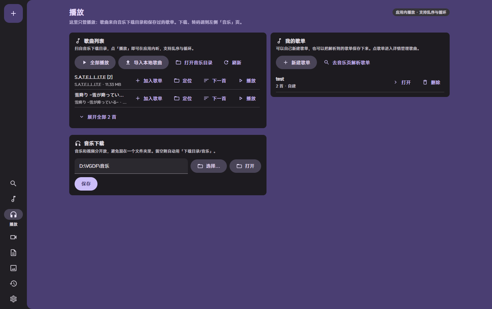
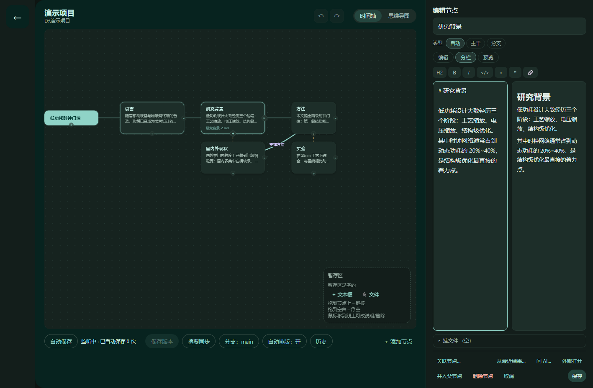
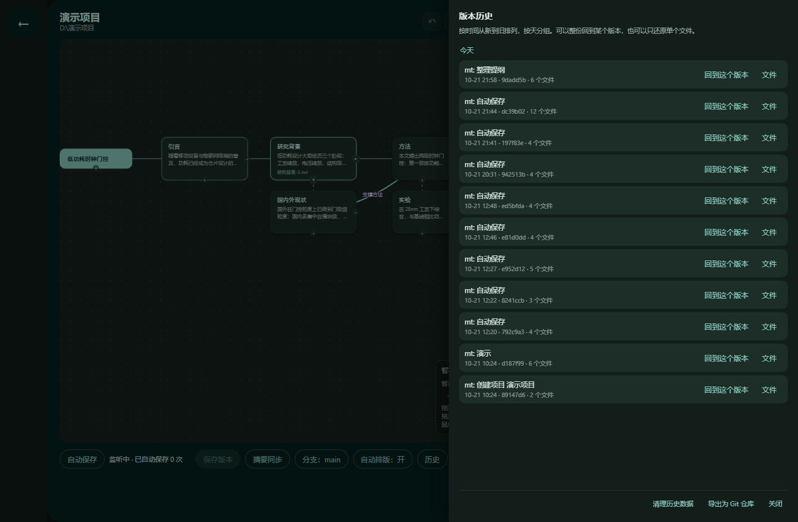

# Makise Toolkit

> 写论文用的本地工具。提纲与正文并列呈现，一个节点对应一段内容，每次保存生成一个版本，可随时回退。
> 转格式、找论文、认扫描件也在这儿，不联网也能写。

**v4.0.1 快照版** · Windows 10/11 x64

> ⚠️ 快照版，不是稳定版。日常能用，但还没被长时间折腾过。
> 先拿新项目试，重要的稿子另外存一份普通文件夹。
> 稳定版请看 [Releases](https://github.com/PLSSJX/BLG/releases)。
>
> 安装包：`MakiseToolkit-Setup-4.0.1.exe`（122 MB，Windows 10/11 x64）——
> 在 [v4.0.1-snapshot](https://github.com/PLSSJX/BLG/releases/tag/v4.0.1-snapshot) 下下载。



---

## 界面截图

> 4.0 的主线是论文写作，所以先看这两张：导图式提纲，和能回退的版本历史。

### 项目：节点就是章节



每个节点写一段正文，存进项目文件夹里的 .md。连线表示「支撑」「对比」，
拖节点、拉连线、随手加分支，不用先把提纲想完整。

### 版本：随时回退



点保存记一版，自动保存也记。可以整份回退，也可以只还原某一个文件；
回退连节点结构一起回到那个样子。

### 其余页面

| 页面 | 做什么 |
| --- | --- |
| 文档 | Word / Excel / Markdown / PDF 互转，扫描件走 OCR（[截图](docs/screenshots/05-doc.png)） |
| 文献 | 检索 → 下载即入库 → 生成 GB/T 7714 / APA / IEEE / MLA / BibTeX / RIS |
| 设置 | 主题、目录、AI 助手、其他功能开关（[截图](docs/screenshots/08-settings.png)） |

### 其他功能（默认关闭）

视频下载、音乐、剪辑、图片放大，还有一个「找资源」，都在这里。
**默认不显示**，在设置里打开「其他功能」才会出现在左侧。

老截图留着给需要的人看：[解析](docs/screenshots/01-parse.png) ·
[音乐](docs/screenshots/02-music.png) · [播放器](docs/screenshots/03-player.png) ·
[剪辑](docs/screenshots/04-clip.png) · [图片](docs/screenshots/06-image.png)

**找资源** 是把 [FMHY](https://fmhy.net)（FreeMediaHeckYeah）那份公开目录抓成本地索引来搜：
两万多条，搜的是站名和分组，点结果用系统浏览器打开。
第一次用要联网抓一次（约 1～2 分钟），之后搜索完全离线。

> 程序不托管任何内容，也不替这些站担保。目录是别人整理的，
> 有些站在你所在地区可能不合法，点之前自己判断。

## 数据安全（4.0 重点验证过）

论文工具最不能接受的是丢稿，所以这几条是自动化测过的，不是"应该没问题"：

| 场景 | 结果 |
| --- | --- |
| 编辑中强杀进程（`taskkill /F`） | 重启后正文与版本历史都在 |
| 断电模拟（直接改盘 + 强杀） | 内容不丢，还能继续提交 |
| 回退到旧版本 → 再写 → 再回退 | 没有「幽灵内容」 |
| 15 次连续快速保存 | 正文是最新一次，版本没漏 |
| 100+ 个版本 | 时间线加载 30–40ms，回退 30–50ms |
| 一键备份 | zip 里含 `.mt/` 版本库与正文，解开就能用 |
| 附件 | 存的是**副本**，改它不影响原文件 |
| 版本库目录被删 | 自动重建，正文不动 |
| 版本库文件损坏 | 坏库改名留档、建新库；项目照常打开，历史从空重记 |

测试脚本：`tests/e2e/scenarios/data-safety.mjs`（28 项，会自己杀进程再拉起来）。

## 目录

- [能做什么](#能做什么)
- [数据安全](#数据安全4-0-重点验证过)
- [快速开始](#快速开始)
- [项目与版本](#项目与版本)
- [检索与引用](#检索与引用)
- [文档转换](#文档转换)
- [其他功能（默认关闭）](#其他功能默认关闭)
- [系统托盘](#系统托盘)
- [隐私说明](#隐私说明)
- [文件安全](#文件安全)
- [从源码运行](#从源码运行)
- [自己打包](#自己打包)
- [已知限制](#已知限制)

---

## 能做什么

| 模块 | 能力 | 默认 |
|---|---|---|
| **项目** | 思维导图式提纲，节点 = 章节，正文写进项目里的 .md | 开 |
| **版本** | 每次保存留一版，整份回退或只还原单个文件，可导出成 git 仓库 | 开 |
| **文献** | OpenAlex / Crossref / DOAJ / PubMed / Semantic Scholar 检索，下载即入库，按 DOI 去重 | 开 |
| **引用** | GB/T 7714（中英文）、APA、IEEE、MLA、BibTeX、RIS | 开 |
| **文档** | Word / Excel / Markdown / PDF 互转；扫描件走 OCR（Windows 自带引擎，零下载） | 开 |
| **AI** | 可选，自己填 API key，只在点「问」时发送命中的片段 | 开（需配 key） |
| **视频下载** | B站 / 抖音 / 小红书 / 芒果TV / 腾讯视频 / 优酷 / 爱奇艺 / YouTube | 关 |
| **音乐** | 网易云 / QQ音乐 单曲与歌单，加密格式解密，应用内播放 | 关 |
| **视频剪辑** | 裁剪、分离音轨、分离画面 | 关 |
| **图片放大** | bigjpg 免费通道，无需登录 | 关 |
| **系统托盘** | 常驻托盘，右键直达各页面；菜单跟着工具箱开关走 | 开 |

---

## 快速开始

### 用打包好的 exe（不需要装 Python）

1. 运行安装程序，或把 `dist\\MakiseToolkit\\` 整个目录拷到任意位置
2. 双击 `MakiseToolkit.exe`
3. 首次启动会自己建 `data/` 和 `downloads/` 两个目录

程序内置 WebView2 窗口，**不会弹浏览器**。如果系统缺 WebView2 运行时，会给出提示和下载链接。

### 从源码运行（需要 Python 3.10+）

```bash
python start.py            # 打开桌面窗口
python start.py serve      # 只起服务，用浏览器访问 127.0.0.1:8931
```

---

## 项目与版本

1. 「项目」页点左上角 ＋，选一个**空文件夹**（这就是你的项目目录）
2. 进项目后：双击空白处不再乱建节点，用底部「＋ 添加节点」或节点右侧的 ＋
3. 选中节点 → 右侧编辑栏写正文 → Ctrl+Enter 保存
4. 每次保存自动留一版；「历史」里可以整份回退，也可以只还原某个文件

项目目录里有什么：

```
我的论文/
├── 引言.md / 研究背景.md …   正文，普通 Markdown
├── assets/<节点名>/           挂进来的附件（副本）
└── .mt/                       版本库（history.db），别手动改
```

> 正文就是 .md 文件，用 Typora / VS Code 直接改也没问题，回来程序会认。
> 但 `.mt/` 别删 —— 删了正文还在，历史会没（程序会重建一个空库）。

## 检索与引用

「文献」页搜关键词，结果里点下载就进库（按 DOI 去重）。
选中条目可以复制引用：

* 中文 GB/T 7714、英文 GB/T 7714、APA、IEEE、MLA
* BibTeX、RIS（直接贴进 LaTeX / EndNote）

---

## 视频下载

### 支持的平台

| 平台 | 状态 | 说明 |
|---|---|---|
| **哔哩哔哩** | ✅ 完整 | 多条独立抓取通道，自动选最高可及画质 |
| 抖音 | ✅ | 需要分享链接 |
| 小红书 | ✅ | 需要分享链接 |
| 芒果TV / 腾讯视频 / 优酷 / 爱奇艺 | ✅ | 直链解析 |
| YouTube | ✅ | 依赖内置 yt-dlp |

### B 站的多条通道

程序会**并行试所有通道**，取画质最高的那条。界面上有「对比结果」面板，列出每条通道给出的画质。

**未登录最高 720P**，登录后依账号权限走高画质。

---

## 音乐

### 下载

支持**网易云** 和 **QQ音乐** 的单曲与**整张歌单**。

> 歌单支持情况：
> - ✅ 网易云、QQ音乐 —— 可直接解析整张歌单
> - ❌ 酷我 —— 老接口只剩元数据，歌曲列表已被移除；新接口有反爬
> - ❌ 酷狗 —— 接口需要 md5 签名
> - ❌ Spotify —— API 需要 OAuth，且本身不提供音频流

上表三家的**单曲链接**仍可尝试直接解析，只是「整张歌单」用不了。

### 换源搜索

Spotify 这类只给元数据、不给音频流的平台，用「换源搜索」按「歌名 + 歌手」去网易云、QQ音乐找同名歌曲，**结果上会标出它来自哪个平台**。

### 本地加密格式解密

| 平台 | 格式 |
|---|---|
| 网易云 | `.ncm` |
| QQ音乐 | `.qmc0/.qmc3/.qmcflac/.qmcogg`、`.mflac/.mflac0`、`.mgg/.mgg1` |
| 酷狗 | `.kgm/.kgma` |
| 酷我 | `.kwm` |
| 咪咕 | `.vpr` |

解密后可按需转成 mp3 / flac / m4a / wav，并写入 ID3 标签（作者、专辑、曲名）。

### 播放

- 独立「播放」页，和下载页分开
- 歌曲列表默认收起只露 2 首，展开后**限高内部滚动**
- 展开后才有搜索框（可按曲名或作者过滤）
- 播放顺序一个按钮循环：**顺序 → 列表循环 → 单曲循环 → 乱序**
- 每首歌可「加入歌单」「定位」（在资源管理器选中）「下一首播放」
- 播放条可展开「播放列表」面板，点任意一首直接跳过去

### 歌单

- 可以**自己新建**空歌单，也可以保存解析到的平台歌单
- 点歌单进详情：两列网格，带封面、曲名、作者小字
- 详情里可搜索、可移除单曲、可「添加歌曲」（从本地音乐里勾选）
- 已在歌单内的歌会明确提示「这首歌已经在《xxx》里了」

### 封面与标签

- 歌曲列表读 **ID3v2.2/2.3/2.4、ID3v1、FLAC Vorbis 注释** 取曲名、作者、专辑
- 没标签就退回文件名
- 下载时若保存了 `cover.jpg` 等图片，会作为封面显示

---

## 视频剪辑

侧边栏「剪辑」页，或从「历史记录」里点视频文件，都会打开播放器覆盖层，底部有一排工具：

| 工具 | 说明 |
|---|---|
| **取当前为起点** | 把播放位置填进起点框 |
| **快速裁剪** | `-c copy`，几秒出结果；**切口对齐到关键帧**，实际起止可能偏差 1 秒以上 |
| **精确裁剪** | 重新编码，逐帧准确，慢一些 |
| **分离音轨** | 抽成 mp3 |
| **分离画面** | `-an` 去掉音轨；容器装不下时自动退回重编码 |

时间格式支持 `12`、`1:05`、`0:01:30`。**起止超出视频长度会直接报错**，不会产出半个文件。

### 本地视频也能剪

点「选择本地视频」，在系统对话框里选文件即可。允许播放的范围是「下载目录 + 音乐目录 + 你在对话框里亲手选过的文件」，**同目录里没选中的文件仍然拒绝**。

---

## 文档转换

| 源 | 可转成 |
|---|---|
| `.docx` Word | `.xlsx` / `.md` / `.pdf` |
| `.xlsx` Excel | `.docx` / `.md` / `.pdf` |
| `.pdf` PDF | `.docx` / `.xlsx` / `.md` |
| `.md` Markdown | `.docx` / `.xlsx` |

**Word / Excel / Markdown 之间是完整读写**，表格会保留成真表格，不是一堆文本。

### Word / Excel → PDF 有两条通路

| 通路 | 依赖 | 特点 |
|---|---|---|
| ① 本机 Office（优先） | 装了 Word/Excel | 版式最准，分页页眉页脚都保留；首次调用要冷启动，约 5–10 秒 |
| ② 无头 Edge / Chrome 打印 | 有 Edge（Win10/11 自带） | 不需要 Office，1–2 秒；复杂文档排版会和 Word 原样不同 |

装了 Office 走 ①，没装自动落 ②。两条都不通时会明确报错，**不会产出坏文件**。

### PDF 作为源文件的限制

PDF 只**抽取文本**，不还原版式：

- 扫描件、图片型 PDF 没有文字层，抽不出来
- 用 CID 子集字体嵌入的中文 PDF，抽出来可能是乱码
- 版面、图片、页眉页脚都不会保留

这是 PDF 格式本身的限制，不是实现问题。

---

## 图片放大

侧边栏「图片」页，走 [bigjpg](https://bigjpg.com/) 的**免费通道，无需登录、无需 API key**。

- 支持 2× / 4× / 8× / 16×（免费账号只有 2× / 4×）
- 五档降噪：无 / 低 / 中 / 高 / 最高
- 照片模式与卡通插画模式

> **该页面使用 bigjpg。** 图片会上传到 bigjpg 的服务器处理，这是该功能的必要前提。

---

## 系统托盘

启动后常驻系统托盘。

- **左键双击** → 打开主界面
- **右键菜单**：
  - 显示主界面
  - 播放 / 暂停 · 上一首 · 下一首
  - 播放方式：顺序 / 列表循环 / 单曲循环 / 乱序
  - 直达各页面：解析 / 音乐 / 播放 / 剪辑 / 文档 / 图片 / 历史记录 / 设置
  - **退出**（会一并停掉后台服务）

托盘菜单是 Windows 原生菜单，只能跟随系统深色/浅色，**没法做成 Material 3 样式**。

---

## 隐私说明

### 数据存在哪

| 内容 | 位置 |
|---|---|
| 配置（含 Cookie） | `data/config.json` |
| 任务记录 | `data/tasks.json` |
| 本地歌单 | `data/playlists.json` |
| 下载的媒体 | 你设置的下载目录 |
| 音乐 | 你设置的音乐目录（默认 `<下载目录>/音乐`） |

全部在**本机**。程序没有任何「上传统计」「云端同步」行为。

### 网络请求

程序只会向以下目的发请求：

1. 你主动解析的**平台**（B站、抖音、网易云等）
2. **bigjpg** —— 仅在你使用图片放大时，且页面上有明确标注
3. **ffmpeg 下载源**（gyan.dev / BtbN）—— 仅在你点「下载 ffmpeg」时
4. **更新检查** —— 仅在你点「检查更新」时

### 凭据

- Cookie（SESSDATA、MUSIC_U 等）只保存在本地 `data/config.json`
- **不会**写进日志、不会出现在错误信息里
- 界面上的凭据输入框是密码类型
- 下载文件名、任务标题里不含凭据

### 本机接口防护

HTTP 服务只监听 `127.0.0.1`，并且：

- 每个进程生成随机 `api_token`，所有写操作必须带 `X-MakiseToolkit-Token` 头
- 校验 `Origin` / `Host`，防止网页跨站请求
- `/media` 只放行下载目录、音乐目录，以及**你在系统对话框里亲手选过的文件**

---

## 文件安全

这个工具会删文件，所以约束写得很死。以下每一条都有对应测试（`python tests_safety.py`，73 项全绿）。

### 删除任务的文件时

- **只删记录在 `task.files` 里的产物**，不再整目录 `rmtree`
- 每条路径都要通过 `relative_to(任务目录)` 校验，`..` 和绝对路径越界一律跳过
- 程序自己的中间文件（`_parts`、`*.bgpart`、`*.part`）才按模式匹配
- 最后用 `rmdir` 收尾 —— **只在目录空了才删得掉**
- 动手前界面会把「将删除哪些文件」列出来让你确认

### 安装 / 卸载时

- 卸载只删安装时写过清单的文件
- 清单里没有的文件一律保留并报告出来
- 盘根安装会自动嵌一层 `MakiseToolkit`，不会铺满整个盘

### 下载时

- 目标目录用 `.videograb` 标记认领，**不会写进用户自己的同名文件夹**
- 同名任务并发时自动用 `(2)` `(3)` 区分
- 已有文件不会被覆盖

### 转码 / 解密时

- 输出一律走 `_unique_path()`，同名自动加序号
- 不覆盖任何已有文件

---

## 从源码运行

```bash
# 纯标准库后端，不用装依赖
python start.py

# 起服务 + 浏览器
python start.py serve

# 命令行下载
python start.py download BV1xx411c7mD --qn 80
```

### 自检

```bash
python tests_safety.py     # 安全测试
```

---

## 自己打包

```bash
python build.py --onedir --windowed --with-ytdlp --with-webview2
python install.py          # 复制到 %LOCALAPPDATA%\\Programs\\MakiseToolkit 并重建快捷方式
```

`install.py` 每次都会**重建桌面和开始菜单快捷方式**。

---

## 已知限制

| 限制 | 原因 |
|---|---|
| 4.0 是快照版，未经过长时间验证 | 建议先在新项目上试，重要论文另留一份文件夹备份 |
| 版本库 `.mt/` 被删 / 损坏后历史会丢 | 正文不受影响；坏库会留档成 `.broken-<时间>`，可人工抢救 |
| OCR 的 Tesseract 自动下载在部分网络下超时 | 可在设置里手动指定安装包；Windows 自带 OCR 引擎不需要下载 |
| 酷我 / 酷狗 / Spotify 歌单不可用 | 对方接口加了防护，不是实现问题 |
| 网易云会员歌曲下不了 | 需要账号的 `MUSIC_U`，且账号得有对应会员 |
| PDF 抽文本会乱码 | CID 子集字体嵌入的 PDF，标准做法无法还原 |
| Word → PDF 需要 Office 或 Edge | 见上文两条通路 |
| B站未登录最高 720P | 平台限制 |
| 托盘菜单样式跟随系统 | Windows 原生菜单无法自定义外观 |

---

## 许可

仅用于个人学习与研究。请遵守各平台的服务条款，不要用于商业用途或大规模抓取。
