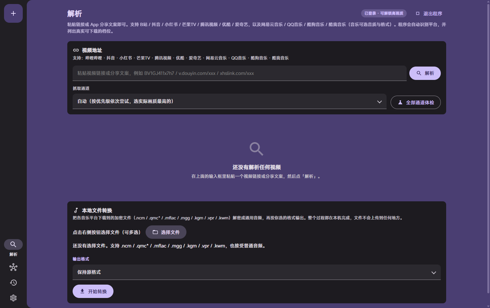
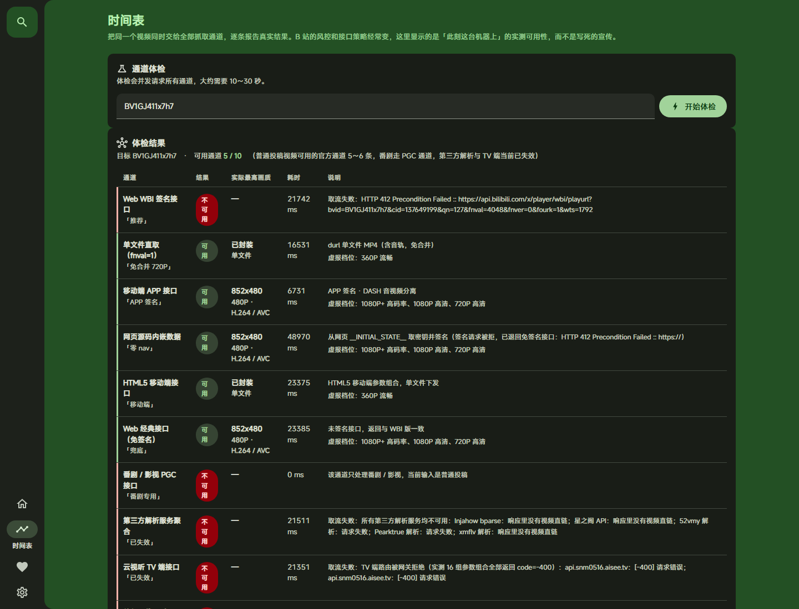
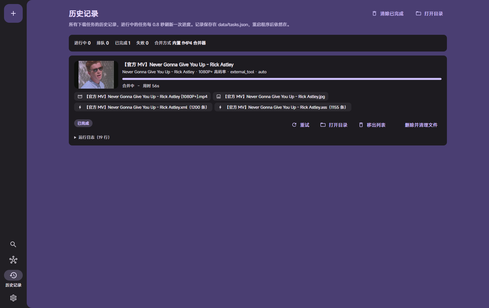
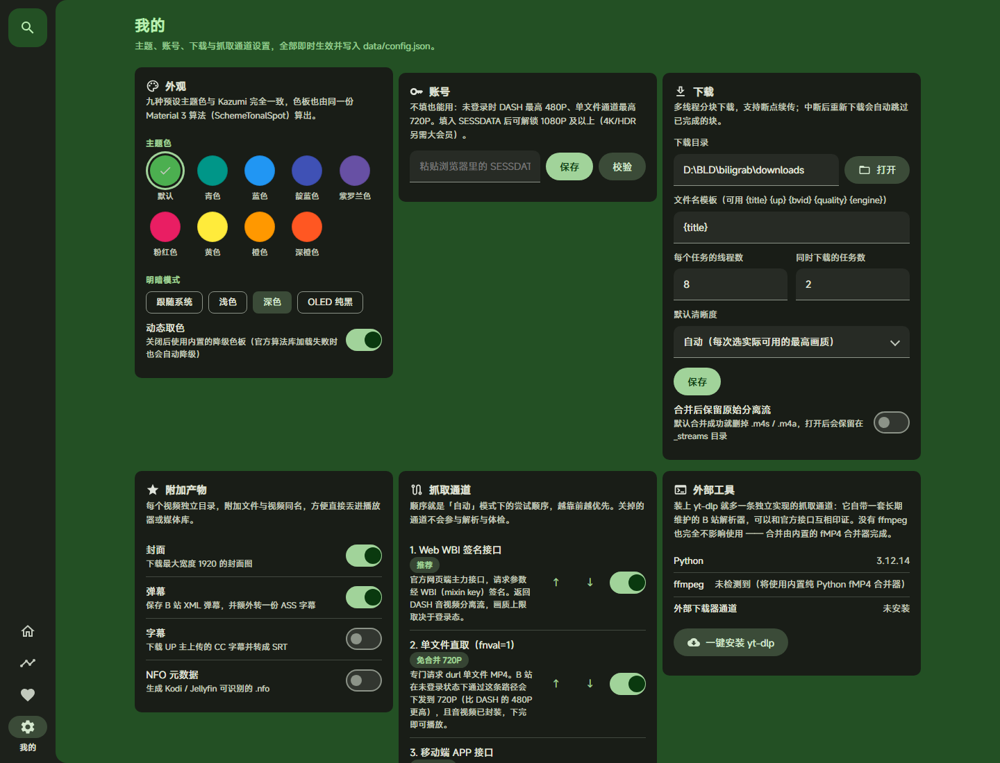

# Video-Grabing

一个跨平台的视频采集器：粘贴链接或 App 分享文案就能解析并下载，
支持 **B站 / 抖音 / 小红书 / 芒果TV / 腾讯视频 / 优酷 / 爱奇艺** 七个平台。

- 在 B 站上做到了 **十条互相独立的抓取通道**，可自选清晰度、可勾选分 P 批量下载
- **多线程断点续传下载**，没有 ffmpeg 也能合并 DASH 音视频
- 一个**完全复刻 Kazumi 视觉语言的 Material 3 界面**，独立桌面窗口、不依赖浏览器

- **独立桌面窗口**：内置 WebView2 渲染，不依赖浏览器、没有标签栏和地址栏
- 后端 **纯 Python 标准库**，零第三方依赖，`python start.py` 即可运行
- 前端原生 HTML / CSS / ES Module，没有构建步骤
- 没有 ffmpeg 也能用：内置一个自己写的 **fMP4 合并器**，把 DASH 音视频分离流合成标准 MP4
- 带 **.exe 安装程序**、**自动更新** 与 **自检修复**（比对仓库基线哈希，坏了自动重下）



---

## 一、支持的平台

粘贴链接或 App 分享文案即可，程序会自动识别平台。**下面每一行的能力都是实测出来的**，
不是照着文档写的：

| 平台 | 状态 | 实测能力 | 已知限制 |
|---|---|---|---|
| **哔哩哔哩** | 可用 | 10 条独立抓取通道；未登录 DASH 480P / 单文件 720P；内置 yt-dlp 通道实测 **1080P** | 1080P+ 需填 SESSDATA，4K/HDR 需大会员 |
| **抖音** | 可用 | 免登录拿**无水印成品直链**；实测 4K HEVC 单文件 377.7 MB 下载成功 | CDN 强制校验抖音 Referer（已处理）；私密/已删作品取不到 |
| **小红书** | 可用 | 视频笔记成品 mp4；实测 720×1280 / 14.9 MB 下载成功 | 只支持视频笔记，图文笔记如实报错；走国际版 RedNote 移动页 |
| **芒果TV** | 可用 | 720P/576P/480P 三档 **HLS**；实测 31 个分片拼成 46.1 MB | 只下发 HLS，输出 MPEG-TS（装 ffmpeg 后自动转 MP4）；1080P 需会员 |
| **腾讯视频** | 可用 | 免签名免登录拿 MP4 直链；UGC 实测完整 720P / 58.5 MB | 会员内容只有约 180 秒试看；vkey 有效期约 6 小时 |
| **优酷** | 可用 | 移动页内嵌数据拿单文件直链；实测 720P / 3.4 MB | 匿名只能拿平台下发的那一档，不能自选画质；会员片不下发播放源 |
| **爱奇艺** | 可用 | 复现了 vf 签名；免费剧集实测 8 段 720P 全片 416 MB | 未登录最高 720P（请求更高会被静默降级）；会员片只有约 6 分钟试看 |

### 各平台是怎么拿到的

- **抖音**：短链 302 取出 `aweme_id`，再请求 SEO 落地页 `douyin.com/shipin/0?modal_id=`，
  从 RSC 直出的 `__pace_f` 数据里取完整作品 JSON（`bitRateList` 里的成品 mp4）。
  官方 `/aweme/v1/web/aweme/detail/` 需要 `a_bogus` 签名，已放弃。
- **小红书**：`xhslink.com` 短链 307 展开；国内站无 token 时只回登录壳，
  兜底走国际版 RedNote 移动页 `rednote.com/discovery/item/{id}` 的内嵌数据。
- **芒果TV**：`pcweb player/video` 拿元数据与 `pm2` → `tinker.glb.mgtv.com/player/getSource`
  拿分档地址 → 拼域名再请求一次得到 m3u8 直链。
- **腾讯视频**：`vv.video.qq.com/getinfo` 免签名直接返回带 `vkey` 的 MP4 直链。
- **优酷**：元数据走官方开放接口 `openapi.youku.com/v2/videos/show.json`；
  播放地址在移动页 `m.youku.com` 的 `window.__INITIAL_DATA__` 里（**必须用移动端 UA**，桌面 UA 会被风控）。
- **爱奇艺**：短号→`tvid` 的异或换位算法、以及 `cache.video.iqiyi.com/dash` 的 `vf` 签名
  都从官方播放器 bundle 里读出来复现了；分片地址再经 `data.video.iqiyi.com/videos` 换成 CDN 直链。
  注意 dash 接口会把请求的画质静默降级，只有标了 `_selected` 的那一档才真正带分片表。

> 所有适配器都只用 Python 标准库，不装任何第三方包。
> 遇到风控、会员墙、地区限制时会**如实报错**并写清原因，不会伪造地址。

---
## 二、十条抓取通道（哔哩哔哩）

B 站是唯一做了多通道的平台：每条通道都是独立实现，有各自的接口、签名方式和失败模式。界面的「时间表」页会把同一个视频
丢给全部通道跑一遍，逐条报告**此刻这台机器上**的真实可用性 —— 而不是写死的宣传。

| # | 通道 | 做法 | 实测结果（未登录） |
|---|---|---|---|
| 1 | **Web WBI 签名接口** | `/x/player/wbi/playurl`，用 nav 下发密钥做 mixin_key 混洗 + `w_rid` 签名 | 可用 · DASH 480P |
| 2 | **单文件直取（fnval=1）** | 专门请求 durl 单文件 MP4 | 可用 · **720P 单文件，免合并** |
| 3 | **移动端 APP 接口** | 伪装 Android 客户端，appkey/appsec 全参数 MD5 签名 | 可用 · DASH 480P |
| 4 | **网页源码内嵌数据** | 抓 HTML，从 `__INITIAL_STATE__` 取元数据与站点内嵌的 `defaultWbiKey`，自己算密钥签名 | 可用 · 480P，**全程不请求 nav** |
| 5 | **HTML5 移动端接口** | `platform=html5&high_quality=1`，服务端直接回封装好的 MP4 | 可用 · 单文件 MP4 |
| 6 | **Web 经典接口（免签名）** | 裸调 `/x/player/playurl`，不签名 | 可用 · DASH 480P，WBI 失效时的兜底 |
| 7 | **番剧 / 影视 PGC** | `pgc/view/web/season` + `pgc/player/web/playurl`，处理 ep / ss 号 | 可用 · 番剧 480P（付费内容仅试看） |
| 8 | 第三方解析服务聚合 | 轮询 7 个公开解析接口挖直链 | 实测取流接口**全部失效** |
| 9 | 云视听 TV 端接口 | TV appkey 签名请求 `/x/tv/playurl` | 网关无条件返回 `-400` |
| 10 | 外部下载器（yt-dlp / lux） | 调用本机已有的成熟下载器；打包版可内置 | 可用 · **实测 1080P** |

**普通投稿视频开箱可用 6 条通道**（打包版装上 yt-dlp 后是 7 条），番剧另走 PGC 通道。第 8、9 条完整保留代码并在界面上
如实标注失效原因 —— 它们随时可能恢复，届时无需改动即可工作。



### 实测出来的几个关键事实

下面的结论来自本项目对 B 站接口的实测（原始证据见 [docs/channel-probe-report.md](docs/channel-probe-report.md)），
也是代码里那些"看起来奇怪"的写法存在的原因：

1. **未登录时 DASH 最高只有 480P，但 durl 单文件能给到 720P。**
   所以程序在「自动」模式下会比较两条通道的实际分辨率，挑画质更高的那条走。
2. **`accept_quality` 会虚报。** 未登录时接口声称支持 `[112, 80, 64, 32, 16]`，
   但 `dash.video` 里实际只有 480P 和 360P。因此界面只显示**真实下发到的档位**，
   虚报的那些画成虚线并标注「需登录 / 需大会员」。
3. **`window.__playinfo__` 在桌面播放页已经废弃**（页面上只剩一个恒为 undefined 的守卫）。
   但 `__INITIAL_STATE__.defaultWbiKey` 仍然可用，通道 4 正是靠它做到零 nav 请求。
4. **CDN 是双重防盗链**：必须同时带 `Referer: https://www.bilibili.com/` 和桌面 Chrome UA，
   否则一律 403。
5. **HTML 必须按 gzip 魔术字节解压**：服务端会无视 `Accept-Encoding: identity` 直接回 gzip。
6. **接口对突发请求非常敏感**，并发高了会吃 412。客户端因此实现了接口域名限速 +
   命中风控后全局冷却，并且只用 Range 探测长度（不带 Range 会真的把 20MB 全量拉下来）。

---

## 三、清晰度

支持 B 站全部 13 档清晰度：

| qn | 画质 | qn | 画质 | qn | 画质 |
|---|---|---|---|---|---|
| 127 | 8K 超高清 | 112 | 1080P+ 高码率 | 64 | 720P 高清 |
| 126 | 杜比视界 | 100 | 智能修复 | 32 | 480P 清晰 |
| 125 | HDR 真彩 | 80 | 1080P 高清 | 16 | 360P 流畅 |
| 120 | 4K 超清 | 74 | 720P60 高帧率 | 6 | 240P 极速 |
| 116 | 1080P60 高帧率 | | | | |

画质选择器有三层信息：**实际下发的档位**（可选）、**接口虚报的档位**（虚线 + 原因）、
以及每条流的分辨率 / 编码 / 码率 / 体积。同一档画质 B 站会同时下发 H.264、H.265、AV1
三个版本，可以按需选择（默认 H.264，兼容性最好）。

想要 1080P 及以上，需要在「我的 → 账号」里填入浏览器里的 `SESSDATA`；4K / HDR / 杜比
另需大会员。

---

## 四、下载与合并

- **分块多线程**：默认 8 连接，4MB 一块，块级断点续传（中断后重跑自动跳过已完成的块）
- **主备 CDN 自动切换**：主地址失败会依次尝试 `backupUrl` 里的其它 CDN
- **HLS 分片下载**：芒果TV 这类只给 m3u8 的平台，按播放列表逐片下载再拼接成文件
  （未加密的 MPEG-TS，纯标准库即可；带 #EXT-X-KEY 加密时会明确报错而不是产出坏文件）
- **分 P 勾选批量下载**：多 P 视频会列出每一 P 的标题和时长，勾选后逐个建立独立任务
  （每个 P 的进度、重试、失败原因互不影响），带全选 / 反选 / 清空
- **五种下载模式**：自动 / 单文件 MP4（免合并）/ 强制 DASH / 仅音频 / 仅元数据
- **附加产物**：封面、XML 弹幕 + 转好的 ASS 字幕、CC 字幕转 SRT、Kodi / Jellyfin 可识别的 NFO
- **任务历史落盘**，重启后仍在；上次没跑完的会标成「已中断」，可一键重试

### 内置 fMP4 合并器

B 站的 `.m4s` 是 CMAF 分片格式：`ftyp → free → moov → sidx → (moof → mdat)*`
（`moov` 里的样本表是空的，真正的样本信息全在 `moof/traf/trun` 里）。
因此**不需要重新编码**，只要：

1. 各取一次两个流的 `ftyp + moov`
2. 把两条轨道的 `moov` 合成一个：合并 `mvhd`、两条 `trak`、
   `mvex`（`mehd` / `trex` / `trep`），音频轨改号并同步改写
   `tkhd.track_ID` 与 `trex.track_ID`
3. 按 `tfdt` 解码时间把两边的 `moof + mdat` 交错写出，同时把音频分片的
   `tfhd.track_ID` 改成新号

输出结果经过实际解码验证：合并得到的 MP4 在 Chrome 里能正常播放，
时长 212.31 秒、分辨率 853×480，与源流一致。

如果本机装了 ffmpeg，程序会优先用它（`-c copy` 重封装）；没有就自动走内置合并器，
两条路径对用户透明。

---

## 五、界面：复刻 Kazumi

界面按 Kazumi（`Predidit/Kazumi`）的设计语言逐项对齐，设计令牌直接取自其源码：

| 项目 | Kazumi | 本项目 |
|---|---|---|
| 色板 | Material 3 `ColorScheme.fromSeed` | 同一份官方 `material-color-utilities`，`SchemeTonalSpot` |
| 预设主题色 | 九种（默认 `Colors.green`） | 完全相同的九种 |
| 卡片圆角 / 封面圆角 | 10 / 12 | `--radius-card: 10px` / `--radius-img: 12px` |
| 卡片间距 / 安全边距 | `cardSpace = 8` / `safeSpace = 12` | `--space-card: 8px` / `--space-safe: 12px` |
| 封面宽高比 | `16 / 10` | `--card-aspect: 16 / 10` |
| 外壳布局 | 背景 `surfaceContainer`，内容区 `primaryContainer` 圆角色板（左上 / 左下 16） | 同左 |
| 侧边导航 | `NavigationRail`，`leading` 是 elevation 0 的搜索 FAB，导航项贴底，`labelType = selected` | 同左 |
| 竖屏 | 切换成底部 `NavigationBar` | 760px 断点切换 |
| 深色 / OLED | 支持纯黑 OLED 主题 | 支持，`--md-surface: #000` |

四个页面对应 Kazumi 的四个导航项：

- **推荐** —— 解析视频、选通道、选清晰度、发起下载
- **时间表** —— 十通道体检矩阵
- **追番** —— 下载队列与历史
- **我的** —— 主题色 / 账号 / 下载 / 附加产物 / 通道管理 / 外部工具

主题色板由 Material 3 算法**实时计算**后写入 CSS 变量，所以色值与 Kazumi 一致，
而不是"看着差不多"的近似色。取色库已内联到 `web/vendor/`，不依赖外网 CDN。

<p align="center">
  
  
</p>

---

## 六、快速开始

### 方式一：直接用打包好的 exe（不需要装 Python）

`dist` 目录里就是成品，双击即可，浏览器会自动打开界面：

| 产物 | 说明 |
|---|---|
| `dist\Video-Grabing\Video-Grabing.exe` | **完整版**，约 42 MB。内置 Python 运行时 + 界面资源 + yt-dlp，启动快，`bin\` 目录可自行替换 ffmpeg |
| `dist\Video-Grabing.exe` | **单文件便携版**，约 10 MB。一个文件拷走就能用，适合放 U 盘 |
| `dist\Video-Grabing-Setup-1.0.0.exe` | **安装程序**，约 43 MB。装到 `%LOCALAPPDATA%\Programs\Video-Grabing`，自动建快捷方式并注册到「应用和功能」 |

安装程序支持静默安装（适合脚本批量部署）：

```bat
Video-Grabing-Setup-1.0.0.exe                            :: 图形界面安装
Video-Grabing-Setup-1.0.0.exe /S /D=D:\Tools\Video-Grabing   :: 静默安装到指定目录
```

卸载既可以从「应用和功能」里点，也可以运行安装目录下的 `uninstall.exe`。
卸载时默认**保留下载好的视频和配置**，需要在卸载界面取消勾选才会一起删。

程序第一次运行时会在 **exe 所在的目录**创建两个文件夹：

```
Video-Grabing/
├── Video-Grabing.exe
├── data/          配置与下载历史（换机器直接删掉即可重置）
├── downloads/     下载产物
├── bin/           想手动放 ffmpeg.exe / yt-dlp.exe 就丢这里
└── .deps/         界面里「一键安装」装的依赖
```

> 打包版把「只读资源」和「可写数据」严格分开了：界面文件在 exe 内部的解包目录里，
> 而 `data/` 和 `downloads/` 始终跟着 exe 走。
> 否则单文件版每次退出都会把用户配置和下载记录一起删掉。

#### 创建桌面快捷方式

```bat
python create_shortcut.py                :: 桌面快捷方式
python create_shortcut.py --start-menu   :: 桌面 + 开始菜单
python create_shortcut.py --remove       :: 删掉
```

快捷方式指向**完整版** `Video-Grabing.exe`，带图标和工作目录，双击即启动并自动打开浏览器。
它用系统 API 取真实桌面路径，所以开了 OneDrive 桌面重定向也不会建错地方。

为了让它双击起来像个正常程序，目录版是用 `--windowed`（无控制台）打的，同时做了这几件事：

- **不弹黑框，但命令行照样能用**。`launcher.py` 会先尝试 `AttachConsole` 接回父进程的控制台，
  所以 `Video-Grabing.exe probe BV1xx411c7mD` 在终端里有输出，双击时则安静启动。
- **有日志**。没有控制台时输出写到 `data\Video-Grabing.log`（超过 1MB 自动轮转）。
- **出错看得见**。启动失败会弹消息框，而不是默默什么都不发生。
- **单实例**。重复双击不会报「端口被占用」，而是直接把已经在跑的那个界面打开。
- **能从界面退出**。「我的 → 程序 → 退出程序」会停掉后台服务；关掉浏览器标签页是不会停的。

### 方式二：从源码运行（需要 Python 3.9+）

源码运行同样**不需要安装任何第三方包**。

```bat
:: 双击 run.bat，或者：
python start.py
```

浏览器会自动打开 <http://127.0.0.1:8931/>。

```bat
python start.py --port 9000        :: 换端口
python start.py --no-browser       :: 不自动开浏览器
```

### 命令行

```bat
python start.py engines                          :: 列出全部通道及可用性
python start.py probe BV1GJ411x7h7               :: 用这个视频体检所有通道
python start.py download BV1GJ411x7h7 --qn 64    :: 直接下载，不开界面
python start.py download BV1GJ411x7h7 --mode audio
```

### 深链

`http://127.0.0.1:8931/?input=BV1GJ411x7h7#home` 打开即自动解析，方便当书签或分享。

---

## 七、HTTP API

| 方法 | 路径 | 说明 |
|---|---|---|
| GET | `/api/state` | 通道清单、设置、主题预设、清晰度表、运行状态 |
| GET | `/api/tasks` | 任务列表与统计 |
| POST | `/api/parse` | 解析元数据 |
| POST | `/api/play` | 取播放地址（返回真实可用画质 + 虚报画质） |
| POST | `/api/probe` | 十通道体检 |
| POST | `/api/tasks` | 新建下载任务 |
| POST | `/api/tasks/cancel` · `retry` · `remove` · `clear` | 任务操作 |
| POST | `/api/settings` | 更新设置 |
| POST | `/api/engines/order` | 通道启用与排序 |
| POST | `/api/tools/install` | 把 yt-dlp 装进项目自带的 `.deps` |
| GET | `/api/cover?url=` | 封面代理（绕过图床防盗链） |
| GET | `/media?path=` | 播放本地文件，支持 Range |
| GET | `/api/ping` | 存活探测（单实例检测用） |
| POST | `/api/quit` | 停止服务（桌面版没有控制台，只能从这里退出） |

---

## 八、项目结构

```
videograb/
├── dist/                       打包产物：Video-Grabing.exe
├── build.py                    打包脚本：自动装 PyInstaller 并生成 exe
├── create_shortcut.py          创建桌面 / 开始菜单快捷方式
├── make_manifest.py            生成自检基线 update/manifest.json
├── installer/                  .exe 安装程序与卸载程序
├── update/manifest.json        自检基线（需提交到仓库）
├── launcher.py                 PyInstaller 入口
├── start.py / run.bat          源码方式启动
├── videograb/
│   ├── config.py               设置持久化与全局上下文
│   ├── net.py                  HTTP 客户端：限速、风控冷却、重试、Range
│   ├── wbi.py                  WBI 签名
│   ├── appsign.py              APP / TV 端 appkey 签名
│   ├── refs.py                 输入解析（BV / av / 链接 / 短链 / 番剧 / 各平台 ID）
│   ├── quality.py              清晰度码表、编码偏好
│   ├── sites/                  平台适配层：bilibili / douyin / xiaohongshu /
│   │                           mgtv / vqq / youku / iqiyi
│   ├── engines/                B 站的十条抓取通道（e1 … e10）
│   ├── hls.py                  HLS(m3u8) 分片下载与拼接
│   ├── downloader.py           分块多线程下载器
│   ├── muxer.py                ffmpeg 探测 + 自写 fMP4 合并器
│   ├── extras.py               弹幕 / 封面 / 字幕 / NFO
│   ├── tasks.py                任务调度与持久化
│   └── server.py               HTTP 服务与 JSON API
└── web/                        界面（无构建步骤）
```

运行时会生成 `data/`（配置与任务历史）和 `downloads/`（下载产物）。

---

## 九、自己打包成 exe

`build.py` 会自动建一个构建用的虚拟环境并安装 PyInstaller，不需要你事先准备任何东西：

```bat
python build.py                     :: 单文件便携版（默认）
python build.py --onedir            :: 目录版，启动更快
python build.py --all               :: 两种都打
python build.py --onedir --with-ytdlp    :: 顺手把 yt-dlp 一起打进去
python build.py --onedir --with-ffmpeg   :: 顺手把静态 ffmpeg 一起打进去（约 +80MB）
```

打包做了这几件事：

1. 用 Pillow 现场画一个多尺寸 `.ico`（纯图形，不依赖字体或 SVG 渲染器）
2. 建 `.build-venv` 并安装 PyInstaller —— 不污染系统 Python
3. 把 `web/` 整个界面资源通过 `--add-data` 打进包里
4. 排除 `tkinter` / `numpy` / `PIL` 等用不到的模块控制体积
5. `--with-ytdlp` 时把 yt-dlp 装进 `.deps` 再 `--collect-all` 收进 exe

### 打包版里 yt-dlp 是怎么工作的

exe 里的 `sys.executable` 是 `Video-Grabing.exe` 而不是 python，
所以 `python -m yt_dlp` 这种调用方式在打包后会失效，`pip` 也不存在。
通道 10 因此走了一条**进程内**路径：直接把 `yt_dlp` 当普通模块导入并调用它的 Python API，
不需要任何外部解释器。相应地，打包版里的「一键安装 yt-dlp」按钮会改为提示
「把 yt-dlp.exe 放进 bin 目录」而不是尝试联网安装。

**顺带一个实测收获**：内置 yt-dlp 这条通道能拿到 **1080P**，
而官方那几条通道在未登录时最高只有 480P（durl 720P）。
实测下载并合并出的 1080P 文件在 Chrome 里解码正常：1920×1080、212.31 秒。
所以想要免费的高画质，第 10 条通道是最划算的一条。

---

## 十、独立桌面窗口

程序**不依赖浏览器**。启动后是一个属于本进程的原生窗口，任务栏图标、标题、尺寸都由自己控制。
按可用性分三层降级，「设置 → 更新与自检 → 运行方式」会如实显示当前用的是哪一种：

| 方式 | 说明 |
|---|---|
| **内置 WebView2 窗口** | 首选。pywebview + pythonnet 驱动系统自带的 WebView2 运行时，窗口属于本进程 |
| Edge 应用模式 | 没有 pywebview 时退而求其次：`msedge --app=`，无标签栏无地址栏的独立窗口 |
| 系统默认浏览器 | 最后手段 |

HTTP 服务仍然跑在后台，但只监听 `127.0.0.1`，且所有写操作都要带一次性令牌 +
校验 `Origin` / `Host` —— 否则浏览器里任意网页都能跨站调用本机接口
（比如把代理改到攻击者的服务器上，把 SESSDATA 骗走）。

---

## 十一、自动更新与自检修复

仓库里有 `update/manifest.json`，记录每个界面文件的 SHA-256。

- **自检**：把本地文件逐个算哈希比对，报出缺失 / 被改动 / 读不了的文件
- **修复**：从更新源重新下载并覆盖。只要有一个界面文件不对，就把整个 `web/` 重下一遍 ——
  因为 exe 同级的 `web/` 是一个**覆盖层**，必须自洽，不能一半新一半旧
- **更新**：比对版本号，有新版可一键下载安装包（下载后校验 SHA-256 再允许运行）

```bat
python start.py update              :: 检查更新
python start.py update --verify     :: 只自检，不改动任何文件
python start.py update --repair     :: 自检并修复
python start.py update --download   :: 有新版时直接下载安装包
```

### 关于更新源

实测在部分网络下 `raw.githubusercontent.com` 完全不可达，所以更新源按可达性排序：

1. `cdn.jsdelivr.net/gh/PLSSJX/BLG@main/`（优先）
2. `raw.githubusercontent.com/PLSSJX/BLG/main/`（兜底）

断网时还能用包里自带的那份基线做离线自检（这份不含安装包哈希，因为构建顺序决定了它必然比发布版旧）。

### 打包后怎么修

exe 里的代码封在 PyInstaller 的解包目录里，改不了。所以 `web/` 的解析顺序是
**「exe 同级的 web/ 覆盖层」优先，其次才是包内的只读副本** —— 修复程序把文件下到覆盖层，
重启后即生效。

---

## 十二、已知限制

- **各平台的上限与限制见第一节的表格**，那里写的是实测结果。
- **未登录画质上限**：B 站官方通道 DASH 480P / 单文件 720P，更高需要 `SESSDATA`；
  但第 10 条通道（内置 yt-dlp）实测可以直接拿到 1080P。
- **会员内容**：4K、HDR、杜比视界、付费番剧需要对应权限，程序会如实提示而不是假装成功。
- **第三方解析与 TV 端当前已失效**，通道保留待其恢复。
- 请仅将本工具用于**个人学习与备份自己有权访问的内容**，遵守哔哩哔哩的用户协议与
  相关法律法规，不要用于批量抓取或二次分发。
